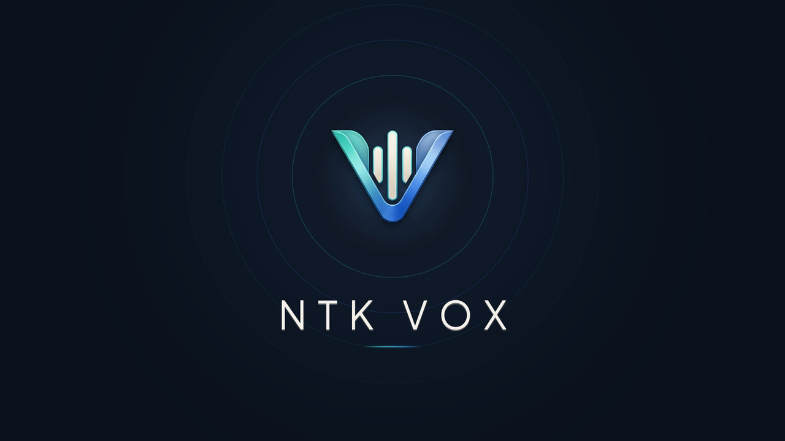

<div align="center">
  
</div>

# NTK VOX

**NTK VOX** is an offline, voice-activated (VOX) and continuous audio recorder for Android, built with Kotlin and Jetpack Compose.

In **Voice-Activated (VOX)** mode, NTK VOX listens quietly in the background without saving silence to disk. When someone speaks, it automatically writes the audio (including the 2 seconds right before the voice started, so the first word is never cut off) and pauses again after a configurable quiet period. You can also switch to **Continuous (Normal)** mode anytime to record nonstop like a standard voice recorder.

> **100% Offline & Private by Design:** Look at [`app/src/main/AndroidManifest.xml`](app/src/main/AndroidManifest.xml) and you will notice the app does **not** even request Android's `INTERNET` permission. Your recordings, transcripts, and summaries never leave your phone unless you choose to export or share them.

---

## Download & Install on Android

You do **not** need Android Studio, coding knowledge, or a computer to use NTK VOX. Download the app directly onto any phone running **Android 10 or newer**:

- **[Download NTK VOX v1.0 APK (Android 10+, Release-Signed, 47.57 MB)](https://github.com/appdevmanwill/NTKVox/releases/latest/download/NTK-VOX-v1.0.apk)**
- **[View GitHub Releases Page, SHA-256 Checksum & Signing Fingerprint](https://github.com/appdevmanwill/NTKVox/releases/latest)**

### Quick 4-Step Phone Install
1. Open the direct APK download link above on your Android phone.
2. When the download finishes, tap the `.apk` file from your browser downloads or your phone's **Files** app.
3. If Android asks for permission to install unknown apps, tap **Settings**, turn on **Allow from this source**, and tap **Back**.
4. Tap **Install**, then open **NTK VOX** and follow the 2-step setup guide.

*(Want to compile the app yourself? Jump to [Beginner Step-by-Step Setup (Build & Run)](#beginner-step-by-step-setup-build--run) below.)*

---

## Table of Contents

- [Download & Install on Android](#download--install-on-android)
- [Who This App Is For](#who-this-app-is-for)
- [Key Features](#key-features)
  - [1. Two Recording Modes](#1-two-recording-modes)
  - [2. Voice Sensitivity & Zero-AI Noise Guard](#2-voice-sensitivity--zero-ai-noise-guard)
  - [3. Audio Formats & File Sizes](#3-audio-formats--file-sizes)
  - [4. Crash-Safe Storage & Automatic Protection](#4-crash-safe-storage--automatic-protection)
  - [5. Background Recording, Battery Profiles & Schedules](#5-background-recording-battery-profiles--schedules)
  - [6. Playback, Bookmarks & Organization](#6-playback-bookmarks--organization)
  - [7. Offline Audio Editing](#7-offline-audio-editing)
  - [8. Offline Transcription, Summaries & Exporting](#8-offline-transcription-summaries--exporting)
  - [9. Appearance](#9-appearance)
- [Requirements](#requirements)
- [Beginner Step-by-Step Setup (Build & Run)](#beginner-step-by-step-setup-build--run)
  - [Step 1: Get the Source Code](#step-1-get-the-source-code)
  - [Step 2: Create `debug.keystore` (Required Before First Debug Build)](#step-2-create-debugkeystore-required-before-first-debug-build)
  - [Step 3: Environment File (`.env`)](#step-3-environment-file-env)
  - [Step 4: Open and Run in Android Studio (Easiest for Beginners)](#step-4-open-and-run-in-android-studio-easiest-for-beginners)
  - [Step 5: Build & Install from the Command Line (Optional)](#step-5-build--install-from-the-command-line-optional)
- [Building a Signed Release APK or App Bundle](#building-a-signed-release-apk-or-app-bundle)
- [Running Tests](#running-tests)
- [First-Time App Usage & Permissions Explained](#first-time-app-usage--permissions-explained)
- [Project Structure & How It Works](#project-structure--how-it-works)
- [Tech Stack](#tech-stack)
- [Troubleshooting for Beginners](#troubleshooting-for-beginners)

---

## Who This App Is For

- **Meetings, lectures, and interviews:** Leave the recorder running without filling your storage with empty pauses.
- **Overnight or all-day voice monitoring:** Built to run reliably with the screen turned off, save in crash-safe segments, and stop safely before battery or storage runs out.
- **Users who want full privacy:** No cloud accounts, no subscriptions, and no network permissions.

---

## Key Features

### 1. Two Recording Modes

- **Voice-Activated (VOX) Mode (Default):**
  - Keeps a **2.0-second pre-roll ring buffer** in memory while listening, so the opening syllables of speech are preserved when recording starts.
  - Waits for roughly **96 ms** of confirmed voice activity before opening an audio clip on disk, preventing accidental triggers from short clicks or bumps.
  - Keeps recording through short pauses for your chosen **Silence Stop Delay** (**5 to 60 seconds**, default **10 seconds**). If someone speaks again before the timer finishes, it continues seamlessly in the same clip.
  - Automatically rotates long uninterrupted speech into a new segment every **15 minutes** so a single giant file never gets corrupted.
- **Continuous (Normal) Mode:**
  - Records everything nonstop from the moment you tap Record until you tap Stop (or a timer/safety limit triggers).

### 2. Voice Sensitivity & Zero-AI Noise Guard

NTK VOX uses a pure-Kotlin, zero-AI Digital Signal Processing (DSP) detector (`EnergyVadDetector`) that runs with zero per-frame garbage-collection allocations:

- **Stage 1 (Fast Voice-Band Gate):** Runs a **120 Hz to 3,400 Hz** biquad filter to strip low-frequency AC/wind/table rumble and high-frequency hiss. Silent frames skip the heavier FFT step to save battery.
- **Stage 2 (Spectral Speech Classifier):** Computes Voice-Band Energy Ratio, Zero-Crossing Rate (ZCR), and a **512-point FFT Spectral Flatness** score to separate harmonic human speech from steady broadband noise like fans or rain.

Choose from three presets in **Settings > Voice Sensitivity**:

| Preset | Best For | Behavior |
| --- | --- | --- |
| **Quiet Voices** *(Default / Recommended)* | Soft-spoken voices and distant speakers | Lowest speech threshold; catches quiet conversation clearly |
| **Normal Room** | Everyday conversation in busier rooms | Balanced threshold for typical indoor environments |
| **Prominent Only** *(Noise Guard)* | Noisy rooms with fans, AC hum, or hallway chatter | Focuses on close foreground speech and filters out steady background noise |

### 3. Audio Formats & File Sizes

Change your recording format in **Settings > Audio Format** (or from the quick format selector). Changes apply to your next recording session.

| Format | Extension | Approx. Size | Battery Impact | Best For |
| --- | --- | --- | --- | --- |
| **Ogg Opus** *(Default)* | `.ogg` | ~15 MB/hr | Ultra-Low | Smallest files, clear speech, and long crash-safe sessions |
| **M4A / AAC** | `.m4a` | ~28 MB/hr | Ultra-Low | Sharing everywhere (plays on iPhone, Mac, Windows, and Android) |
| **MP3** | `.mp3` | ~28 MB/hr | Medium | Classic universal compatibility (car stereos, older players) |
| **FLAC** | `.flac` | ~65 MB/hr | Low | Lossless audio quality in smaller files than WAV |
| **WAV** | `.wav` | ~115 MB/hr | Ultra-Low | Uncompressed PCM audio for editing apps; also acts as automatic fallback if a device lacks a hardware/software codec |

### 4. Crash-Safe Storage & Automatic Protection

- **Atomic Session Folders:** Each session lives in its own app-private folder (`filesDir/vox_sessions/session_<id>/`) with an atomically written `manifest.json` and periodic disk `fsync`.
- **Automatic Launch Recovery:** When the app opens, `SessionRepository.recoverAndLoadSessions()` silently repairs incomplete WAV headers, AAC ADTS tails, or Ogg page boundaries and promotes interrupted active sessions to `READY` so your captured audio is not lost if the phone shuts down unexpectedly.
- **Low-Storage Protection:** Automatically stops and saves cleanly if free device storage drops below **100 MB**.
- **Low-Battery Auto-Save:** Automatically stops and saves before your unplugged phone shuts off. Default cutoff is **5%**, configurable from **1% to 50%** (or disabled at `0%`) in Settings.

### 5. Background Recording, Battery Profiles & Schedules

- **Foreground Microphone Service:** Keeps recording reliably while the screen is locked and shows a live notification with a **1-tap Stop** button.
- **Automatic Call Pause:** Pauses recording when a phone call starts and displays the status cleanly.
- **Battery & Efficiency Profiles:**
  - **Adaptive Eco** *(Default / Recommended)*: Smooth live audio meters with the screen on; reduces UI/notification wakeups when the screen turns off.
  - **Ultra Battery Saver**: Extra-efficient background sync intervals for multi-day endurance.
  - **Balanced**: Faster live meters and more frequent background syncs.
- **Auto-Stop Timer:** Set a fixed recording timer (up to 24 hours) that saves and stops automatically.
- **Silence Auto-Stop:** Stops and saves the whole session if no voice is heard for your chosen number of minutes (up to 60 minutes, works in both VOX and Continuous modes).
- **Scheduled Recordings & Armed Standby Mode:** Create **Once**, **Daily**, or **Weekly** start/end schedules. You can also **Arm Standby Mode** so NTK VOX waits quietly for your scheduled window and starts/stops on time even with the screen off (rescheduled automatically after device reboot or timezone change via `ScheduleAlarmReceiver`).

### 6. Playback, Bookmarks & Organization

- **Foreground Media3 ExoPlayer:** Plays sessions smoothly in the background with lock-screen and notification media controls (`MediaSession`).
- **Player Controls:** Play/pause, rewind 10s, forward 10s, adjustable playback speed (**0.75x to 2.0x**), **Quiet-Voice Volume Boost** (`LoudnessEnhancer`), **A-B Loop** (repeat any section between point A and point B), and a collapsible mini-player.
- **Bookmarked Moments:** Tap **Mark Moment** during live recording or **Bookmark** during playback to save timestamped markers with custom editable labels.
- **Organize & Find Recordings:**
  - **Starred** favorites filter and **6 Categories**: `General`, `Meetings`, `Notes`, `Lectures`, `Personal`, `Interviews`.
  - **Full-Text Search:** Search across recording titles, summaries, and transcripts.
  - **Sort & Batch Tools:** Sort by Newest, Oldest, Longest duration, Largest size, or Name A-Z; select multiple recordings for batch actions.
  - **30-Day Recently Deleted Trash Bin:** Deleted recordings move to Trash for 30 days so you can restore them anytime or empty Trash manually.
  - **Disk Usage Dashboard:** View exact space used by active recordings, reclaimable Trash, temporary export cache, and free device space right inside Settings.

### 7. Offline Audio Editing

Open **Edit Audio** or **Trim / Split** on any recording to edit non-destructively (with an option to save as a new copy and keep your original):

- **Trim:** Keep only the audio between Start and End markers.
- **Split:** Divide one recording into two separate recordings at your chosen marker.
- **Clean Silence:** Strip long quiet pauses while keeping natural breathing pauses.
- **Clean Voice & Noise:** Two-pass `O(1)`-RAM offline DSP cleanup (`AudioAcousticProfiler` + `ProminentVoiceCleaner`) that measures your room's noise profile, gently reduces steady fan/AC/hum/hiss, and keeps prominent foreground voices clear.

### 8. Offline Transcription, Summaries & Exporting

- **On-Device Transcription:**
  - On **Android 13+ (API 33+)** devices that have an offline speech recognition pack installed, NTK VOX decodes your saved clips to 16 kHz mono PCM and pipes them directly to Android's offline `SpeechRecognizer` (`EXTRA_PREFER_OFFLINE = true`).
  - On **Android 10 to 12** (or devices without an offline speech pack), NTK VOX builds an offline **Acoustic Activity Log** describing detected speech cadence and intensity, and lets you type or dictate notes directly into the transcript editor.
- **Rule-Based Summary (No AI):** `RuleBasedSummarizer` analyzes your transcript deterministically using stop-word filtering, Term Frequency (TF) scoring, sentence position weighting, and decision/action cues to generate a **Concise Summary**, **Key Takeaways**, and **Top Keywords**.
- **Export & Share:**
  - Save playable audio directly to **`Downloads/NTK VOX`** or **`Music/NTK VOX`** via Android `MediaStore`.
  - Share audio files or export transcripts/summaries as **`.txt`** files to any app via Android's Share Sheet.

### 9. Appearance

- Switch between **System**, **Light**, and **Dark** themes.
- Optional **Keep Screen On While Recording** toggle for desk monitoring.

---

## Requirements

### To Use the App
- An Android phone or tablet running **Android 10 (API 29)** or higher (`minSdk = 29`, `targetSdk = 36`).

### To Build from Source
- **Android Studio:** A recent version (Meerkat / Narwhal or newer) that supports **Android Gradle Plugin (AGP) `9.1.1`** and **Gradle `9.3.1`**.
- **JDK:** Java 17 or Java 21 installed and selected as the Gradle JDK (the project compiles bytecode targeting Java 11).
- **Android SDK:** Android SDK Platform **36** (`compileSdk = 36` with minor API level `1`) and Android SDK Build-Tools.
- **Git** (or download the repository ZIP from GitHub).

---

## Beginner Step-by-Step Setup (Build & Run)

Follow these steps in order if you have never built an Android app from GitHub before.

### Step 1: Get the Source Code

Open a terminal (PowerShell on Windows, or Terminal on macOS/Linux) and run:

```bash
git clone https://github.com/appdevmanwill/NTKVox.git
cd NTKVox
```

### Step 2: Create `debug.keystore` (Required Before First Debug Build)

For security reasons, keystore files are excluded from Git (`.gitignore`). However, `app/build.gradle.kts` is configured to sign debug builds with a file named **`debug.keystore`** placed directly in the project root folder (`NTKVox/debug.keystore`) using these exact credentials:

- **Store password:** `android`
- **Key alias:** `androiddebugkey`
- **Key password:** `android`

Pick **either Option A or Option B** below before building:

#### Option A: Generate a fresh `debug.keystore` with `keytool` (Recommended)

Run this single command from inside the `NTKVox` folder (`keytool` comes bundled with your JDK and Android Studio's JBR):

**Windows (PowerShell):**
```powershell
keytool -genkey -v -keystore debug.keystore -storepass android -alias androiddebugkey -keypass android -keyalg RSA -keysize 2048 -validity 10000 -dname "CN=Android Debug,O=Android,C=US"
```

**macOS / Linux:**
```bash
keytool -genkey -v -keystore debug.keystore -storepass android -alias androiddebugkey -keypass android -keyalg RSA -keysize 2048 -validity 10000 -dname "CN=Android Debug,O=Android,C=US"
```

#### Option B: Copy your existing Android Studio debug keystore

If you already built Android apps on your computer, Android Studio created a debug keystore in your home folder. Copy it into `NTKVox`:

**Windows (PowerShell):**
```powershell
Copy-Item "$env:USERPROFILE\.android\debug.keystore" ".\debug.keystore"
```

**macOS / Linux:**
```bash
cp ~/.android/debug.keystore ./debug.keystore
```

### Step 3: Environment File (`.env`)

You do **not** need an API key to run NTK VOX because the app works 100% offline.

The repository includes [`.env.example`](.env.example) for the Secrets Gradle Plugin. If you ever want local environment properties without modifying tracked files, copy `.env.example` to `.env` (`.env` is gitignored). Leaving it absent works out of the box too.

### Step 4: Open and Run in Android Studio (Easiest for Beginners)

1. Launch **Android Studio** and click **Open**.
2. Select the `NTKVox` folder you cloned in Step 1.
3. Wait for Android Studio to download dependencies and finish **Gradle Sync** (the first sync may take a few minutes).
   - If asked to install SDK Platform 36, accept and let Android Studio install it.
4. Connect an **Android 10+ phone** via USB (with **Developer Options > USB Debugging** turned on) or create/start an **Android Emulator** in **Device Manager**.
5. Click the green **Run (`▶`)** button in the top toolbar to build and install NTK VOX.

### Step 5: Build & Install from the Command Line (Optional)

If you prefer using the terminal instead of clicking Run in Android Studio:

**Windows (PowerShell):**
```powershell
# Build the debug APK
.\gradlew.bat assembleDebug

# Or install directly onto a connected phone/emulator
.\gradlew.bat installDebug
```

**macOS / Linux:**
```bash
# Make gradlew executable on first run
chmod +x gradlew

# Build the debug APK
./gradlew assembleDebug

# Or install directly onto a connected phone/emulator
./gradlew installDebug
```

The generated debug APK will be located at:
`app/build/outputs/apk/debug/NTK-VOX-debug.apk`

---

## Building a Signed Release APK or App Bundle

To create a release build for sharing or Google Play distribution, `app/build.gradle.kts` reads a release keystore (alias `upload`) via environment variables:

- `KEYSTORE_PATH`: Path to your `.jks` keystore file (defaults to `my-upload-key.jks` in the project root if unset)
- `STORE_PASSWORD`: Keystore password
- `KEY_PASSWORD`: Key password for the `upload` alias

**Windows (PowerShell):**
```powershell
$env:KEYSTORE_PATH = "C:\path\to\my-upload-key.jks"
$env:STORE_PASSWORD = "your_store_password"
$env:KEY_PASSWORD = "your_key_password"

# Build release APK or Android App Bundle (.aab)
.\gradlew.bat assembleRelease
.\gradlew.bat bundleRelease
```

**macOS / Linux:**
```bash
export KEYSTORE_PATH="/path/to/my-upload-key.jks"
export STORE_PASSWORD="your_store_password"
export KEY_PASSWORD="your_key_password"

./gradlew assembleRelease
./gradlew bundleRelease
```

---

## Running Tests

NTK VOX includes unit tests for the VOX state machine, DSP voice detector, and rule-based summarizer, plus Robolectric and instrumented tests.

**Run local JVM unit tests (no phone/emulator needed):**

```powershell
# Windows (PowerShell)
.\gradlew.bat testDebugUnitTest
```

```bash
# macOS / Linux
./gradlew testDebugUnitTest
```

**Run instrumented Android tests (requires a connected device or running emulator):**

```powershell
# Windows (PowerShell)
.\gradlew.bat connectedDebugAndroidTest
```

```bash
# macOS / Linux
./gradlew connectedDebugAndroidTest
```

---

## First-Time App Usage & Permissions Explained

When you open NTK VOX for the first time, a 2-step onboarding guide walks you through setup. Here is every permission declared in [`app/src/main/AndroidManifest.xml`](app/src/main/AndroidManifest.xml) and why the app asks for it:

| Permission | When Asked | Why NTK VOX Needs It |
| --- | --- | --- |
| `RECORD_AUDIO` | Onboarding Step 1 (Required) | Lets the microphone capture voices and audio. |
| `POST_NOTIFICATIONS` | Onboarding Step 1 (Android 13+) | Shows the live recording/listening notification with a 1-tap **Stop** button, playback controls, and low-storage/battery alerts. |
| `REQUEST_IGNORE_BATTERY_OPTIMIZATIONS` | Onboarding Step 2 / Settings (Optional, Recommended) | Stops Android from killing overnight or screen-off recordings to save battery. |
| `SCHEDULE_EXACT_ALARM` | Only when creating Scheduled Recordings (Android 12+) | Lets scheduled recordings start and stop right on time. |
| `FOREGROUND_SERVICE` / `_MICROPHONE` / `_MEDIA_PLAYBACK` | Automatic (System) | Required by Android to record audio and play back recordings reliably in the background. |
| `WAKE_LOCK` | Automatic (System) | Keeps the CPU awake long enough to flush audio chunks safely during screen-off recording. |
| `RECEIVE_BOOT_COMPLETED` | Automatic (System) | Re-arms your enabled recording schedules after your phone restarts. |

**Tip for reliable overnight recording:** Open **Settings > Background Recording Check** inside the app and set battery usage for NTK VOX to **Unrestricted**.

---

## Project Structure & How It Works

```text
NTKVox/
├── app/
│   ├── build.gradle.kts                 # App module Gradle configuration, SDK 29..36, signing
│   └── src/
│       ├── main/
│       │   ├── AndroidManifest.xml      # Permissions (no INTERNET), services, receivers
│       │   ├── java/com/example/
│       │   │   ├── MainActivity.kt      # Single-activity Compose entry point
│       │   │   ├── audio/               # Pure-Kotlin DSP VAD, pre-roll ring buffer, VOX state machine, silence & noise cleaner
│       │   │   ├── data/                # Dependency graph (ClearVoxGraph) & DataStore settings repository
│       │   │   ├── model/               # Recording modes, audio formats, sensitivity presets, sessions, schedules
│       │   │   ├── service/             # Foreground recording service, Media3 playback service, alarm receiver
│       │   │   ├── speech/              # Offline SpeechRecognizer pipe & deterministic RuleBasedSummarizer
│       │   │   ├── storage/             # Crash-safe chunk writers (OGG/AAC/MP3/FLAC/WAV), remuxer, session & schedule repos
│       │   │   ├── ui/screens/          # Compose UI screens & sheets (Record, Recordings, Player, Settings, Schedules, Trash, Trim/Split)
│       │   │   ├── ui/theme/            # Material 3 Light/Dark themes, typography, colors
│       │   │   ├── util/                # Time, duration, and file size formatters
│       │   │   └── viewmodel/           # ClearVoxViewModel connecting UI to services & repositories
│       │   └── res/                     # Strings, launcher icons, fonts (Plus Jakarta Sans, JetBrains Mono), XML rules
│       ├── test/                        # Unit & Robolectric tests (VoxEngineUnitTest, etc.)
│       └── androidTest/                 # Android instrumented tests
├── gradle/
│   ├── libs.versions.toml               # Centralized dependency & plugin versions
│   └── wrapper/                         # Gradle 9.3.1 wrapper
├── .env.example                         # Template for optional Secrets Gradle Plugin properties
├── build.gradle.kts                     # Top-level Gradle plugins
└── settings.gradle.kts                  # Root project name ("NTK VOX") & :app module
```

### How the VOX Engine Works Under the Hood

```text
  [Microphone 16 kHz PCM]
            │
            ▼
  [2.0s PreRollRingBuffer] ──► [EnergyVadDetector (120–3400 Hz + ZCR + 512-pt FFT)]
                                         │
                                         ▼
  ┌───────────┐   ~96 ms speech   ┌──────────────┐   voice continues   ┌───────────┐
  │ LISTENING │ ────────────────► │ SPEECH_      │ ──────────────────► │ RECORDING │
  │ (no disk) │                   │ CONFIRMING   │   (flushes 2s       │ (streams  │
  └───────────┘                   └──────────────┘    pre-roll!)       │  to disk) │
        ▲                                                                    │
        │                                                                    │ quiet frame
        │                     Silence Stop Delay expires                     ▼
        │                     (5–60s) -> finalize & fsync           ┌──────────────────┐
        └────────────────────────────────────────────────────────── │ HANGOVER_SILENCE │
                         speech resumes before timeout              └──────────────────┘
                                      └──────────────────────────────────────▲
```

---

## Tech Stack

- **Language:** Kotlin `2.4.21`
- **Build System:** Android Gradle Plugin `9.1.1`, Gradle `9.3.1`
- **UI:** Jetpack Compose (BOM `2024.09.00`), Material 3, Extended Material Icons
- **Async & Persistence:** Kotlin Coroutines `1.10.2`, Jetpack DataStore Preferences `1.1.7`, atomic JSON manifests
- **Audio & Playback:** Android `AudioRecord`, `MediaCodec` / `MediaMuxer`, `Media3 ExoPlayer` `1.5.1`, `LoudnessEnhancer`, `Jump3r` `1.0.5` (MP3 encoding)
- **Testing:** JUnit 4, Kotlinx Coroutines Test, Robolectric `4.16.1`, AndroidX Test / Compose UI Test

---

## Troubleshooting for Beginners

### 1. Error: `Keystore file '.../NTKVox/debug.keystore' not found`
You skipped creating `debug.keystore` in the project root. Follow [Step 2: Create `debug.keystore`](#step-2-create-debugkeystore-required-before-first-debug-build) and sync/build again.

### 2. Gradle sync fails with a Java / JDK error
AGP `9.1.1` and Gradle `9.3.1` require a modern JDK (**JDK 17 or JDK 21**).
- In Android Studio, go to **Settings / Preferences > Build, Execution, Deployment > Build Tools > Gradle** and set **Gradle JDK** to **JetBrains Runtime 21** (or JDK 17/21).

### 3. Error: Failed to find target with hash string `android-36`
Open Android Studio's **SDK Manager** (**Tools > SDK Manager**), check **Android 16 (API 36)** (including minor API level 36.1 if listed), click **Apply** to install it, and re-sync Gradle.

### 4. Recording pauses or stops after locking the screen
Some phone brands (Xiaomi, Samsung, Oppo, Vivo, Realme, Huawei) aggressively kill background apps to save battery.
- Inside NTK VOX, open **Settings > Background Recording Check** and follow the on-screen **Device Tip** to set NTK VOX's battery setting to **Unrestricted**.

### 5. Scheduled recordings start a few minutes late
On Android 12 and newer, exact scheduling requires the **Alarms & Reminders** permission. Tap **Allow** on the banner inside the **Schedule** sheet to grant it.

### 6. Transcription creates an "Acoustic Activity Log" instead of spoken words
Full offline word-for-word transcription relies on Android's built-in on-device `SpeechRecognizer`, which requires **Android 13 (API 33) or newer** with an offline speech language pack downloaded on the device. On Android 10 to 12 (or emulators without an offline pack), NTK VOX falls back to an offline **Acoustic Activity Log** and lets you use **Type or Dictate Notes** to summarize your words offline.
